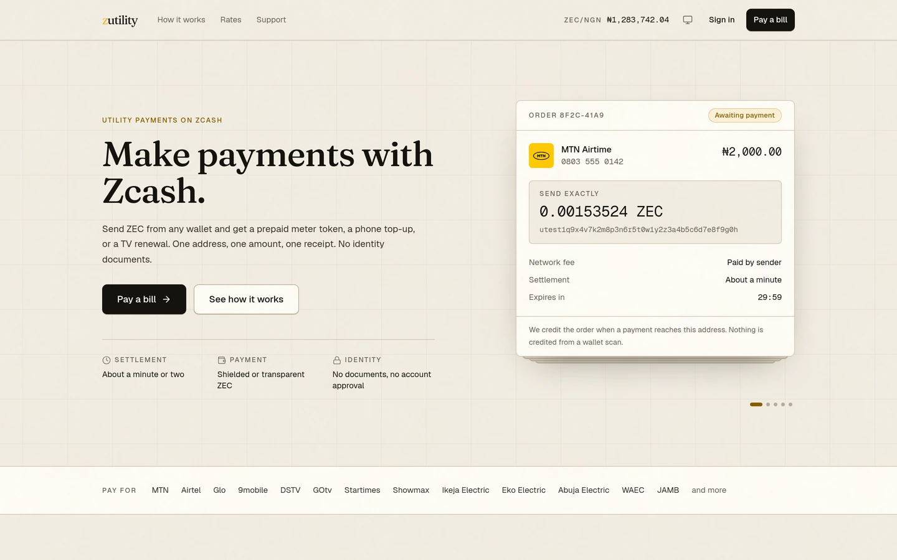
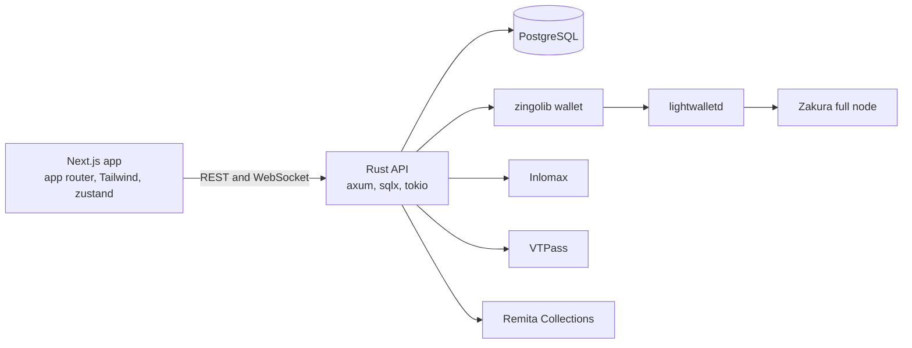

<p align="center">
  
</p>

<p align="center">
  make payments with zcash
</p>

<p align="center">
  <a href="https://zutility.xyz"></a>
  
  
  
  
  
  
  
</p>



## What zutility does

zutility turns a bill into a single Zcash payment. You pick the service, enter the account number, and get one deposit address with one exact ZEC amount. Send that amount from any wallet, shielded or transparent, and the top-up, token, or subscription is delivered after the network confirms the payment.

No account approval, no identity documents, no card on file. Each order gets its own address, so a payment can only ever credit the order it was quoted for.

## Architecture



- **Order engine.** One row per order, driven by a state machine. Transitions are compare-and-set, so a restart or a double tick cannot move an order twice.
- **Payment detection.** The orchestrator scans wallet notes once per tick and groups them by recipient address. An order is credited only by a note sent to its own address, never by a timestamp scan.
- **Confirmations.** Counted from the block height of the note. Order state moves once the threshold is reached, not when the wallet first sees the note.
- **Dispatch.** Provider calls are guarded so a retried tick cannot pay a bill twice. A provider rejection or a stuck dispatch flags the order for review instead of retrying forever.
- **Gifts.** A prepaid utility gift with a claim link, a claim window, and a fallback recipient if nobody claims it.
- **Rates.** A live ZEC rate against the local currency, with snapshots, so every order stores the rate it was quoted at.

## Built with

| Layer | Choice |
| --- | --- |
| Backend | Rust 2024, axum 0.8, sqlx 0.8, tokio |
| Database | PostgreSQL 16 |
| Zcash | zingolib 8.0.0 (NU7), lightwalletd, Zakura |
| Frontend | Next.js 15, React 19, TypeScript 5, Tailwind 4 |
| State | zustand, zod at form boundaries |
| Providers | Inlomax, VTPass, Remita Collections |
| Payments | ZEC, shielded or transparent |

## Repository layout

```text
zutility/
├── zutility-be/          Rust API, order engine, payment detection
│   ├── src/
│   │   ├── domain/       order state machine, gifts
│   │   ├── http/         handlers, middleware, auth
│   │   ├── integrations/ zcash, Inlomax, VTPass, Remita
│   │   ├── runtime/      orchestrator and background workers
│   │   └── db/           queries and transactions
│   ├── migrations/       append-only SQL migrations
│   └── tests/            integration and fixture tests
├── zutility-fe/          Next.js app
│   ├── app/(marketing)/  landing and public pages
│   ├── app/(app)/        dashboard, pay flow, gifts, history
│   ├── components/       UI and marketing components
│   └── lib/              API client, types, helpers
├── deploy/               node and service units
└── docs/                 architecture and API reference
```

## Running locally

**Prerequisites.** Rust 1.85 or newer, Node 20 or newer, PostgreSQL 16.

### Backend

```bash
cd zutility-be
cp .env.example .env          # database URL, JWT secret, provider keys
cargo run
```

The API listens on `127.0.0.1:3001`. `GET /ops/health/ready` reports database, wallet, and indexer health.

For local work without a real indexer, set `ZCASH_BACKEND=mock`. Production refuses to start without a real backend or on a chain mismatch.

### Frontend

```bash
cd zutility-fe
npm install
npm run dev
```

Point it at the API:

```bash
NEXT_PUBLIC_API_URL=http://127.0.0.1:3001
```

### Environment

The backend reads its configuration from the environment. `zutility-be/.env.example` lists every variable, including:

| Variable | Purpose |
| --- | --- |
| `DATABASE_URL` | Postgres connection string |
| `JWT_SECRET`, `ORDER_TOKEN_HMAC_SECRET` | session and order token signing |
| `ZCASH_BACKEND` | `zingolib`, `rpc`, or `mock` |
| `ZCASH_NETWORK` | `testnet` or `mainnet` |
| `ZINGO_INDEXER_URI` | lightwalletd gRPC endpoint |
| `REQUIRED_CONFS_SHIELDED`, `REQUIRED_CONFS_TRANSPARENT` | confirmation thresholds |
| `INLOMAX_*`, `VTPASS_*`, `REMITA_COLLECTIONS_*` | provider credentials |

## Tests

```bash
# backend: unit, domain, config, fixtures
cd zutility-be
cargo test

# frontend types and lint
cd zutility-fe
npx tsc --noEmit
npm run lint
```

Migrations are append-only. Add a new file rather than editing an applied one.

## Design rules the code enforces

- **Server-side amounts.** The client never sets the price of a utility or an RRR. School fees are priced from the Remita lookup, everything else from the order form and the provider catalogue.
- **Address-scoped credit.** A payment credits an order only when the note's recipient equals that order's deposit address.
- **Idempotent side effects.** Webhook and dispatch paths tolerate duplicate delivery. Completions are compare-and-set.
- **No secrets in logs.** The wallet seed stays in the wallet file, provider keys stay in the environment, and errors are logged without them.

## Status

Live on Zcash testnet at [zutility.xyz](https://zutility.xyz). Mainnet infrastructure is being brought up. School fees are pending final Remita settlement confirmation on the sandbox.

## Documentation

- [`docs/Architecture.md`](docs/Architecture.md) for the system design
- [`docs/API-Reference.md`](docs/API-Reference.md) for the HTTP and WebSocket surface

## License

MIT. See [LICENSE](LICENSE).
